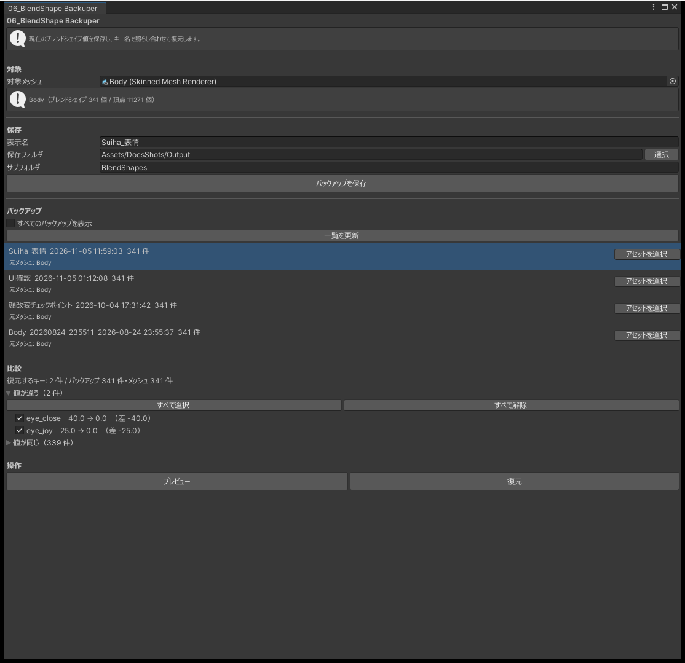

# 06_BlendShape Backuper

`SkinnedMeshRenderer` のブレンドシェイプの値を保存し、あとで戻します。キーの名前と値を組にして保存するので、アバターの更新でキーの並びが変わっても、同じ名前のキーに値を戻せます。

必要なパッケージはありません。

## 使い方

1. 対象のメッシュを指定します。Hierarchy からドロップできます。
2. 名前を確かめて「バックアップを保存」を押します。
3. 保存したバックアップが一覧に並びます。戻すものを選びます。
4. バックアップと今の値の違いが一覧になります。戻すキーにチェックを入れます。
5. 「プレビュー」で見た目を確かめます。
6. 「復元」を押します。

{ .shot loading=lazy }

比べた結果は次のように分かれます。

| まとまり | 内容 |
|---|---|
| 値が違う | 最初からチェックが入っています |
| 値が同じ | 折り畳まれています |
| バックアップにのみ | 今のメッシュに無いキーです。戻せません |
| メッシュにのみ | バックアップに無いキーです |

アバターの更新でキーが増えたり減ったりすると、「バックアップにのみ」「メッシュにのみ」に出ます。

復元は Undo で取り消せます。保存したバックアップのファイルは、Project ウィンドウから削除してください。

## 保存先と保存するもの

既定の保存先は `Assets/zzz_pytr/Avatar-Toolbox/BlendShapeBackups` です。フォルダが無ければ作ります。サブフォルダの名前を指定して、アバターごとに分けることもできます。

保存するのは、キーの名前と値、保存した日時、元のメッシュの名前・パス・識別情報、キーと頂点の数です。値は丸めずにそのまま保存します。

## 別のメッシュに戻す

一覧には、同じメッシュから保存したバックアップだけが出ます。アバターの更新でメッシュが入れ替わったときや、別のアバターに値を移したいときは、「すべてのバックアップを表示」にチェックを入れてください。

別のメッシュから保存したバックアップを選ぶと警告が出ますが、復元はできます。キーは名前で照らし合わせます。

## プレビュー

チェックを入れた値を一時的にメッシュに入れて、見た目を確かめます。「プレビューを終了」を押すと、値は元に戻ります。

ウィンドウを閉じたとき、スクリプトが再コンパイルされたとき、再生を始めたときも、プレビューは終わって値が元に戻ります。プレビュー中の値は、シーンの変更にも Undo の履歴にも残りません。

## よくある質問

### 一覧にバックアップが出ない

アバターを更新してメッシュが入れ替わると、別のメッシュとして扱います。「すべてのバックアップを表示」にチェックを入れてください。

### 戻らないキーがある

今のメッシュに同じ名前のキーが無いキーは戻せません。「バックアップにのみ」に出ています。
