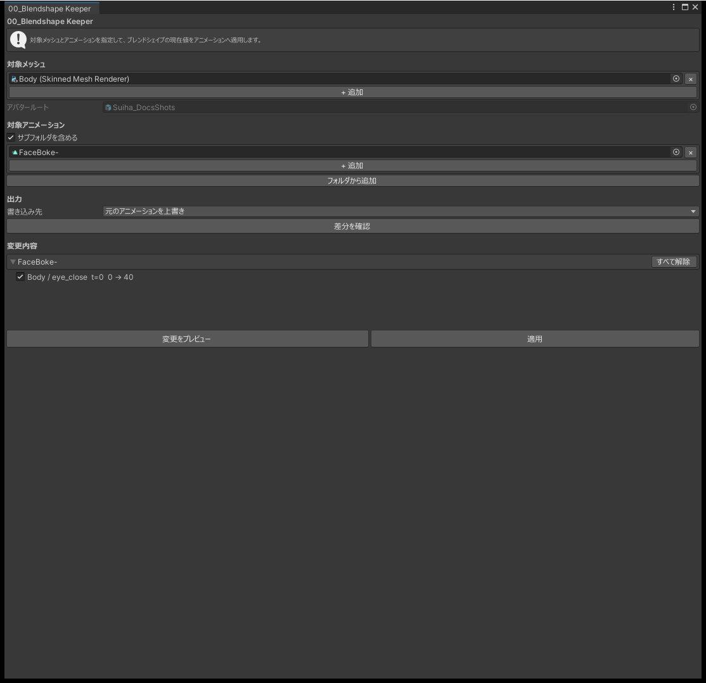
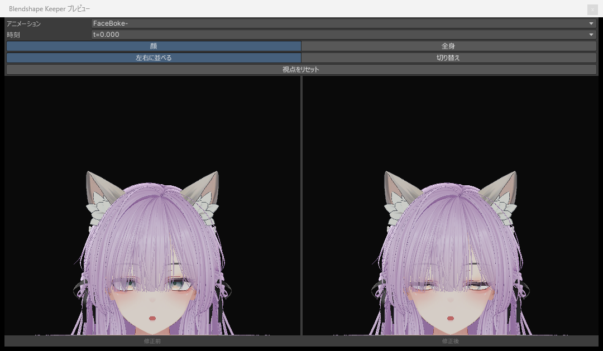

# 00_Blendshape Keeper

顔の改変でブレンドシェイプに値を入れても、表情アニメーションが同じブレンドシェイプを低い値でキーしていると、表情を再生したときに値が戻ってしまいます。このツールは、アニメーションのキーの値を、メッシュに入れた値まで引き上げます。

| アニメーションのキーの値 | メッシュの値 | 適用後のキーの値 |
|---|---|---|
| 20 | 60 | 60 |
| 80 | 60 | 80（変えない） |

キーの値のほうが大きいときは変えません。

## 使い方

1. 「対象メッシュ」に、顔などのメッシュを指定します。複数指定できます。
2. 「対象アニメーション」に、表情のアニメーションを指定します。フォルダをドロップすると、中のアニメーションをまとめて追加します。サブフォルダまで含めるかは「サブフォルダを含める」で選びます。
3. 「差分を確認」を押すと、変わるキーの一覧が出ます。
4. 必要なら「変更をプレビュー」で、変える前と後を見比べます。
5. 適用する行のチェックを確かめ、「適用」を押します。

{ .shot loading=lazy }

アバターのルートは、指定したメッシュにいちばん近い `Animator` から決めます。決められないときだけ、指定する欄が出ます。

対象は指定したメッシュとアニメーションだけです。アバターのメッシュやアニメーションを自動で集めることはしません。

## 書き込み先

| 書き込み先 | 内容 |
|---|---|
| 上書き | 元のアニメーションを書き換えます |
| 別のアニメーションとして保存 | アニメーションを複製し、複製に書き込みます。元のアニメーションは変わりません |

「別のアニメーションとして保存」では、出力フォルダ（`Assets/` か `Packages/` の中）と、名前の末尾に付ける文字（既定は `_Kept`）を指定します。

- 同じ名前のファイルがあるときは、番号を付けた名前で保存します。
- 「変更が無いアニメーションも複製する」をオンにすると、変えるキーが無いアニメーションも複製します。
- FBX の中のアニメーションや `Packages/` の中のアニメーションは上書きできませんが、この方法なら使えます。

## プレビュー

「変更をプレビュー」で別のウィンドウが開き、変える前と後のアニメーションをアバターに再生して見比べられます。

{ .shot loading=lazy }

- 「左右に並べる」と「切り替え」で、見比べ方を選べます。
- 「顔」と「全身」を切り替えられます。左ドラッグで回転、ホイールで拡大縮小、「視点をリセット」で元の視点に戻ります。
- プレビューはツールの中の複製で再生するので、シーンのアバターは変わりません。プレビューから適用はできません。
- 手や体のポーズは再生しません。

## 注意

- 再生中と、Animation ウィンドウでプレビューしている間は使えません。メッシュの値がアニメーションの値に変わっているためです。
- アニメーションに無いブレンドシェイプのカーブは追加しません。
- 変えるのはキーの値だけです。キーの時刻・タンジェント・キーの数は変えません。

## よくある質問

### 「差分を確認」を押しても何も出ない

キーの値がメッシュの値以上なら、変える必要がないので出ません。メッシュにブレンドシェイプの値が入っているか、対象メッシュが合っているかを確かめてください。

### 「ブレンドシェイプが見つかりません」と出る

アニメーションのカーブが、指定したメッシュに無いブレンドシェイプを指しています。衣装など、ほかのメッシュ用のカーブが入っています。

### プレビューにアバターが映らない

「全身」に切り替えて「視点をリセット」を押してください。
