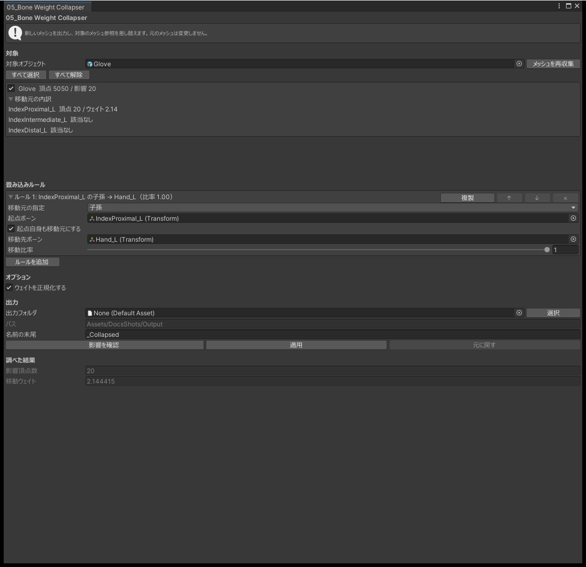

# 05_Bone Weight Collapser

!!! note "非推奨のツールです"
    後継は [C02_Bone Weight Transfer](bone-weight-transfer.md) です。このツールも今までどおり使えます。

メッシュの、あるボーンのウェイトを別のボーンに移します。袖が指のボーンにウェイトを持っていてハンドサインで袖が曲がるときや、スカートの補助ボーン・顔の追従ボーンの影響をなくしたいときに、Blender を使わずに Unity で直せます。

必要なパッケージはありません。

## 使い方

1. 対象のオブジェクトを指定します。中のメッシュが一覧に出ます。
2. 処理するメッシュにチェックを入れます。最初はどれも選ばれていません。
3. 「畳み込みルール」で、移動元のボーンを「直接指定」か「子孫」で指定します。
4. 移動先のボーンと移動比率を指定します。
5. 移動先の違う組み合わせがあれば、「ルールを追加」でルールを増やします。
6. 「影響を確認」を押すと、影響する頂点の数と、移すウェイトの量が出ます。
7. 出力フォルダを指定し、「適用」を押します。

{ .shot loading=lazy }

ウェイトを移しても、止まっているときの見た目は変わりません。変わるのは、動いたときにどのボーンについていくかだけです。頂点の位置・法線・ブレンドシェイプは変えません。

## ルール

移動元・移動先・移動比率の組を「ルール」と呼びます。ルールはいくつでも作れます。たとえば右手の指を `RightHand` へ、左手の指を `LeftHand` へ移すルールを作り、1 回の適用でまとめて処理できます。

- ルールは上から順に適用します。前のルールの移動先を次のルールの移動元にすると、ウェイトは続けて移ります。順番は「↑」「↓」で入れ替えます。
- 「複製」で、入力を引き継いだルールを作れます。左右対称のルールを作るときに使います。
- 移動先のボーンがメッシュのボーンの一覧に無いルールは、そのルールだけが無効になります。理由は「影響を確認」の内訳に出ます。
- ウェイトの正規化の設定は、すべてのルールで共通です。

| 移動比率 | 動き |
|---|---|
| 1.0 | 移動元のウェイトをすべて移します |
| 0.5 | 半分だけ移し、移動元にも半分残します |

## 出力

新しいメッシュを `.asset` として書き出し、対象のメッシュをそれに差し替えます。元のメッシュや FBX は変えません。

- ルールがいくつあっても、出力はメッシュ 1 つにつき 1 つです。
- 同じ名前のファイルがあるときは、番号を付けた名前で保存します。
- 同じメッシュを使い、ボーンの並びも同じ対象は、1 つの出力にまとめます。

## 注意

- 再生中は使えません。
- 移動先には、そのメッシュがもともとウェイトを持っているボーンを指定してください。
- ボーンそのものは削除しません。
- 適用は Undo で取り消せますが、書き出したメッシュのファイルは残ります。

## よくある質問

### どのメッシュもチェックできない

どのルールでも、移動先のボーンがメッシュのボーンの一覧にありません。メッシュがウェイトを持っているボーンを移動先にしてください。

### 追加したルールが効かない

「影響を確認」の内訳で、そのルールが無効になっていないかを確かめてください。

### 「影響を受ける頂点がありません」と出る

移動元のボーンに、そのメッシュのウェイトがありません。移動元を見直してください。

### 適用しても見た目が変わらない

止まっているときの見た目は変わりません。アニメーションを再生して、どのボーンについていくかを確かめてください。

### 元に戻したのにメッシュのファイルが残っている

Undo で戻るのは `SkinnedMeshRenderer` のメッシュの指定だけです。書き出したファイルは、Project ウィンドウから削除してください。
