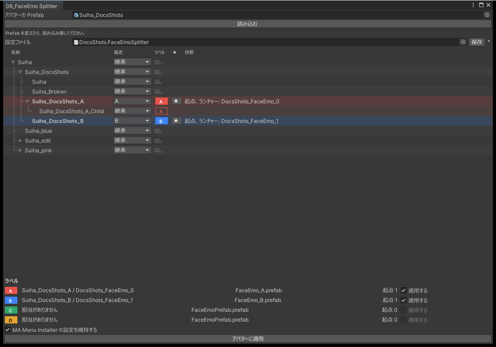
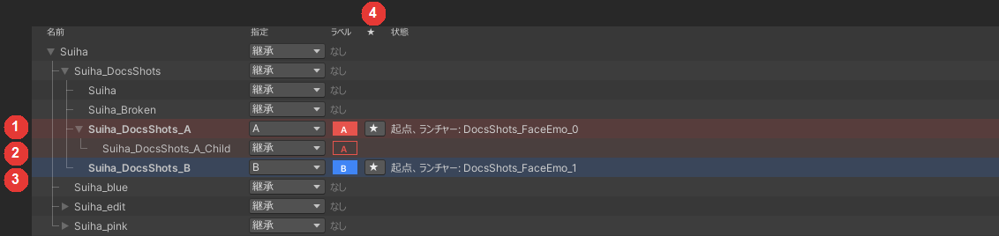

# 08_FaceEmo Splitter

FaceEmo の「アバターに適用」は、表情を Prefab Variant のいちばん上の親に書き込みます。そのため、子の Variant で顔を改変して表情を作ると、親やほかの子にもその表情が入ります。逆に、親で作った表情が、顔を改変した子に入ることもあります。

このツールでは、Variant にラベルを付け、ラベルごとに別の表情を適用します。

必要なパッケージ: FaceEmo 1.7.0 以降（2.x には対応していません）

{ .shot loading=lazy }

## 用語

| 用語 | 意味 |
|---|---|
| ラベル | 同じ表情を使う Variant のまとまりです。A、B、C…と表示します |
| 起点 | ラベルを付けた Variant です。表情はここに入り、その子の Variant が受け継ぎます |
| 担当 | ラベルの表情を作るのに使う Variant です。★で選びます |

## 使い方

1. 表情を分けたい Variant をシーンに置き、FaceEmo でそれぞれの表情を作ります。FaceEmo のランチャーの対象は、その Variant にします。
2. 「アバターの Prefab」に Prefab かシーンのインスタンスを指定し、「読み込む」を押します。保存した設定ファイルがあれば、一緒に読み込みます。
3. 表情を分ける Variant にラベルを付け、ラベルごとに★で担当を選びます。子の Variant はラベルを受け継ぎます。
4. 表情を作り直すラベルの「適用する」にチェックを入れ、「アバターに適用」を押します。確認ダイアログで、書き換える Prefab を確かめてから適用します。

担当の候補が 1 つだけなら、自動で選ばれます。「適用する」を外したラベルは、表情を作り直さず、今の表情のまま配置します。

## Variant の一覧

いちばん上の親から子までの Variant が並びます。名前をクリックすると、Project ウィンドウでその Prefab を選択します。

{ .shot loading=lazy }

| 表示 | 意味 |
|---|---|
| 塗りつぶした札 | その Variant に付けたラベル |
| 枠だけの札 | 親から受け継いだラベル |
| 行の色 | ラベルの色です。起点の行は色が少し濃く、名前が太字です |
| `*` | 指定を変えた行 |

## 設定の保存

「保存」を押すと、ラベル・担当・「適用する」・MA Menu Installer のチェックを、`Assets/` の中の設定ファイル（.json）に保存します。

- 初めて保存するときに、保存する場所を選びます。設定ファイルが決まっていれば、適用が終わったあとに自動で上書きします。
- 「設定ファイル」の欄で、読み込むファイルを選べます。
- Variant の名前や場所を変えても、アバターの配布元の Prefab を同じファイルのまま更新しても、設定は同じ Variant に付いたままです。見つからない Variant があれば、件数が出ます。
- 保存していない変更があると、「保存」の横に `*` が付きます。

## MA Menu Installer の設定を残す

FaceEmo の表情を適用し直すと、メニューのインストール先などが元に戻ることがあります。「MA Menu Installer の設定を維持する」（既定でオン）にしておくと、担当の Variant のシーンで設定したインストール先と、オン・オフを引き継ぎます。引き継ぐのはこの 2 つだけです。

## 注意

!!! warning
    Prefab の書き換えは Undo で戻せません。確認ダイアログに書き換える Prefab が出るので、確かめてから適用してください。事前にコミットするか、バックアップを取ってください。

- 「適用する」の付いたラベルは、書き換える Prefab が 0 件でも表情を作り直します。
- 分けた Variant の表情のオブジェクトは `FaceEmoPrefab (Split)` という名前になります。この名前を変えないでください。
- 分けたあとに FaceEmo の「アバターに適用」を押すと、シーンに FaceEmoPrefab が増えます。増えたものを削除してから、このツールを使ってください。
- 再生中とコンパイル中は使えません。
- Prefab を変えたときは、読み込み直してください。
- サブアバターを設定した FaceEmo のランチャーは使えません。
- ラベルを「継承」にして、表情の無い親に合わせると、その Variant から表情が外れます。
- 書き換えられるのは `Assets/` の中の Prefab だけです。`Packages/` の中の Prefab とモデルは書き換えません。

## よくある質問

### ★が出ない

その Variant をシーンに置き、FaceEmo のランチャーの対象にしてから、読み込み直してください。

### 「シーンに追加された FaceEmoPrefab があります」と出る

FaceEmo の「アバターに適用」で増えたものです。シーンの Variant の中の FaceEmoPrefab を削除してください。

### 「まだ表情が作られていません」と出る

新しく作ったラベルです。担当を選び、「適用する」にチェックを入れてください。

### 適用するとメニューのインストール先が戻る

「MA Menu Installer の設定を維持する」をオンにし、担当の Variant のシーンでインストール先を設定してから適用してください。
