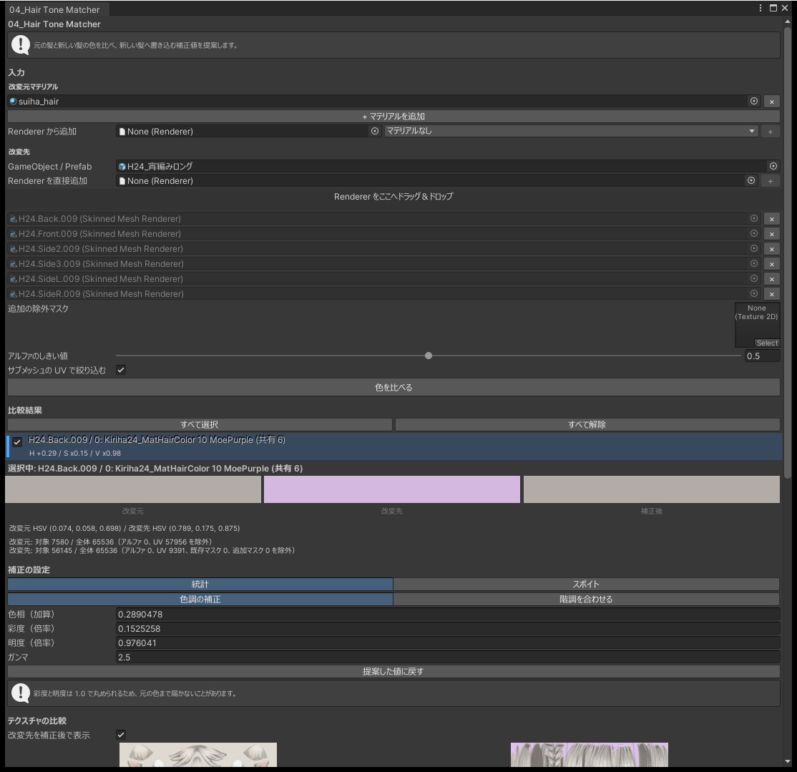
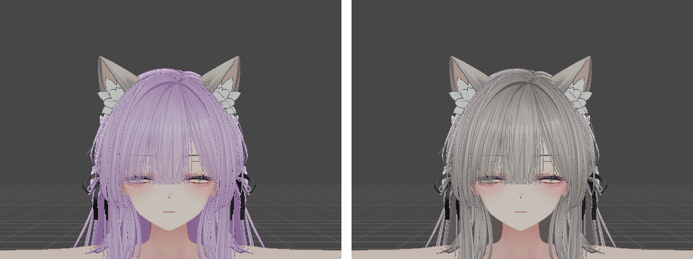

# 04_Hair Tone Matcher

髪を差し替えると、テクスチャやマテリアルの違いで色合いが変わります。このツールは、元の髪と新しい髪のテクスチャの色を比べて補正値を計算し、新しい髪に書き込みます。

必要なパッケージはありません。新しい髪のマテリアルは lilToon か Poiyomi である必要があります。元の髪のマテリアルは、どのシェーダーでもかまいません。

合わせられるのは色だけです。形や陰影の付き方の違いは変わりません。彩度と明度には上限があるので、元の髪より暗い髪を十分に明るくできないことがあります。

## 使い方

1. 「元の髪」に、元の髪のマテリアルを 1 つ以上指定します。マテリアルを直接指定しても、`Renderer` のスロットから追加してもかまいません。
2. 「新しい髪」を指定します。`GameObject`（Prefab でも可）を指定して中の `Renderer` をチェックで選ぶか、`Renderer` を直接追加します。
3. 「色を比べる」を押します。
4. 一覧から対象を 1 つ選び、補正値とプレビューを確かめます。
5. 書き込み先と出力フォルダを確かめ、「適用」を押します。チェックを入れた対象すべてに書き込みます。

{ .shot loading=lazy }

{ .shot loading=lazy }

`Renderer` を追加すると、その `Renderer` のマテリアルスロットがすべて対象に並びます。どれにも最初はチェックが入っていないので、色を変えるスロットにだけチェックを入れてください。髪と髪飾りが同じ `Renderer` の別スロットになっていることがあるためです。

- 元の髪が複数あるときは、すべての画素をまとめて 1 つの目標の色にします。
- 新しい髪は、対象ごとに補正値を計算します。前髪と後ろ髪でテクスチャが違っても、それぞれに合わせます。
- 同じマテリアルを使う対象は、1 つにまとめます。

## 色の合わせ方

目標にする色の決め方を選びます。

| 方法 | 内容 |
|---|---|
| 統計（既定） | テクスチャ全体の代表の色どうしを合わせます |
| スポイト | 元の髪と新しい髪のテクスチャから 1 点ずつ選び、その色どうしを合わせます。選んだ点の周りの平均を使います |

合わせ方を選びます。

| 方法 | 内容 |
|---|---|
| 色調の補正（既定） | 色相・彩度・明度・ガンマで合わせます。統計のときは、明暗の広がりもガンマで合わせます。白飛びが増えるときは補正を弱め、その旨を表示します |
| 階調を合わせる | 色の分布どうしを合わせる曲線を作ります。影やハイライトの色まで合わせられます。統計のときだけ選べます |

## 書き込み先

| 書き込み先 | 内容 |
|---|---|
| 複製 + テクスチャ焼き込み（既定） | マテリアルとメインテクスチャを複製し、補正した色をテクスチャに書き込みます |
| 複製して差し替え（補正は設定として保持） | マテリアルを複製し、補正をシェーダーの設定として書き込みます |
| 上書き | 新しい髪のマテリアルを直接変えます |

補正をシェーダーの設定として持つと、シェーダーがフォールバックしたときに補正が消えます。テクスチャに書き込んでおけば、フォールバックしても色は変わりません。そのかわりファイルが増え、あとから値だけを変えることはできません（[焼き直し](#rebake)はできます）。

上書きでは、同じマテリアルを使うほかのオブジェクトの色も変わります。適用する前に、そのマテリアルを使う `Renderer` の数がウィンドウに出ます。

複製やテクスチャを作るときは、`Assets/` の中の出力フォルダを指定します。階調の LUT や適用範囲のマスクを書き出すときも、同じフォルダに作ります。

## 色を変える範囲

次の条件を重ねて、色を変える範囲を決めます。

| 条件 | 内容 |
|---|---|
| サブメッシュの UV | そのマテリアルスロットが使っている UV の範囲だけを対象にします |
| マテリアルのマスク | マテリアルにすでに設定されている適用範囲のマスク |
| 追加のマスク | 自分で指定したマスクのテクスチャ |
| アルファ | 透明な画素は計算に入れません |

髪飾りが別のマテリアル・別のサブメッシュになっていれば、サブメッシュの UV だけで対象から外れます。

「マスクを書き出す」を選ぶと、この範囲をマスクのテクスチャとして書き出し、マテリアルに設定します。同じテクスチャを使うほかのパーツの色を変えずに、髪の色だけを変えたいときに使います。

## 適用したあとの調整

適用すると、ウィンドウの下に「補正の切り替え」が出ます。

- 「色調補正を使う」で、色調補正をオン・オフできます。オフにすると、適用する前の状態に戻ります。
- コピーしたマテリアルの設定を、機能のまとまりごと・行ごとにオン・オフできます。
- 色調補正の 4 つの値と、コピーした値を直接変えられます。
- 適用したときの値と、変えている値のテクスチャが左右に並びます。

この欄で戻せるのは、ウィンドウを閉じるか再コンパイルされるまでです。

### 焼き直す { #rebake }

「複製 + テクスチャ焼き込み」で適用したときは、「この値で焼き直す」で元のテクスチャから作り直せます。同じパスの PNG を更新するので、ファイルは増えません。

焼き直しは Undo で取り消せません。「階調を合わせる」で焼き込んだテクスチャは焼き直せません。

## マテリアルの設定をコピーする

影の濃さ、リムライト、マットキャップなど、色だけでは合わない部分は、元の髪のマテリアルの設定をコピーして合わせられます。

- 同じシェーダーのマテリアルどうしでだけ使えます。
- 値が違う項目だけが一覧に出ます。最初はどれにもチェックが入っていません。
- 機能のまとまりごとに折り畳めます。プロパティ名や表示名で絞り込めます。
- テクスチャは、マットキャップのように UV を使わないものだけをコピーします。マスクやノーマルマップは新しい髪の UV に合わせて作られているため、コピーしません。

## 注意

- 再生中は使えません。
- 対応していないシェーダーのマテリアル、ロックされたマテリアル、元の髪と同じマテリアルは対象にできません。
- 新しい髪にすでに色調補正が入っているときは、計算した値で置き換えます（足しません）。「色を比べる」を押したときに警告が出ます。
- マテリアルと `Renderer` の変更は Undo で取り消せますが、作ったファイルは残ります。

!!! warning
    マテリアルがロックされていると、値を書き込んでも見た目が変わりません。複製してもロックは外れません。シェーダーのインスペクターでロックを外してから使ってください。

## よくある質問

### 髪の一部だけ色が変わらない

その部分の `Renderer` が対象に入っているかを確かめてください。前髪・後ろ髪・アホ毛が別の `Renderer` のときは、すべて指定します。

### 髪飾りの色まで変わった

髪飾りが髪と同じマテリアルを使っています。追加のマスクで髪飾りを外してください。

### 適用したのに色が変わらない

マテリアルがロックされていないかを確かめてください。シェーダーでその機能がオフになっているときは、インスペクターでオンにしてから使ってください。

### 色を変えたテクスチャが見当たらない

「複製して差し替え（補正は設定として保持）」では、テクスチャを作りません。テクスチャが必要なときは「複製 + テクスチャ焼き込み」を選んでください。

### 別のプロジェクトに移したら色が戻った

シェーダーがフォールバックしています。「複製 + テクスチャ焼き込み」で適用し直してください。

### 元の髪をもう消してしまった

元の髪はマテリアルだけで指定できます。`Renderer` は要りません。

### 重ね塗りの警告が出る

メインテクスチャのほかにレイヤーを使っている髪です。メインテクスチャだけを合わせても、見た目は一致しません。マテリアルの設定のコピーで、レイヤーの設定も合わせてください。
