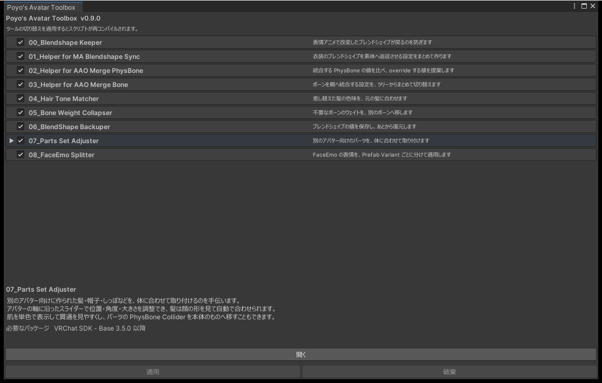

# はじめに

Poyo's Avatar Toolbox は、VRChat のアバター改変で使う小さなエディタ拡張をまとめたパッケージです。使うツールだけを有効にして使います。

## ツールの一覧

| ツール | 内容 | 必要なパッケージ |
|---|---|---|
| [00_Blendshape Keeper](blendshape-keeper.md) | 表情アニメーションで、改変したブレンドシェイプの値が戻らないようにする（非推奨。後継は C01） | なし |
| [01_Helper for MA Blendshape Sync](ma-blendshape-sync.md) | 衣装のブレンドシェイプを素体に追従させる MA Blendshape Sync の設定を、まとめて作る | Modular Avatar 1.17.0 以降 |
| [02_Helper for AAO Merge PhysBone](merge-physbone.md) | 統合する PhysBone の値を比べ、override する値を提案する | AAO: Avatar Optimizer 1.9.0 以降 |
| [03_Helper for AAO Merge Bone](merge-bone.md) | AAO Merge Bone の設定を、ボーンのツリーからまとめて切り替える | AAO: Avatar Optimizer 1.9.0 以降 |
| [04_Hair Tone Matcher](hair-tone-matcher.md) | 差し替えた髪の色を、元の髪の色に近づける | なし（新しい髪のマテリアルが lilToon か Poiyomi） |
| [05_Bone Weight Collapser](bone-weight-collapser.md) | あるボーンのウェイトを、別のボーンに移す（非推奨。後継は C02） | なし |
| [06_BlendShape Backuper](blendshape-backuper.md) | ブレンドシェイプの値を保存し、あとで戻す | なし |
| [07_Parts Set Adjuster](parts-set-adjuster.md) | 別のアバター用の髪や小物を、体に合わせて取り付ける | VRChat SDK - Base 3.5.0 以降 |
| [08_FaceEmo Splitter](face-emo-splitter.md) | FaceEmo の表情を、Prefab Variant ごとに分けて適用する | FaceEmo 1.7.0 以降（2.x は未対応） |

入れた直後は、どのツールも無効です。[設定ウィンドウ](settings.md)で有効にします。無効のツールはコンパイルされません。

{ .shot loading=lazy }

## コンポーネントの一覧

| コンポーネント | 内容 | 必要なパッケージ |
|---|---|---|
| [C00_Animation Helper](animation-helper.md) | 位置・回転・大きさやブレンドシェイプを動かすメニューを、値から作る | Modular Avatar 1.17.0 以降 |
| [C01_Face Keeper](face-keeper.md) | アップロードのとき、全アニメーションの顔のキーを今の値まで引き上げる | NDMF 1.14.0 以降（2.x は未対応）、VRChat SDK - Base 3.5.0 以降 |
| [C02_Bone Weight Transfer](bone-weight-transfer.md) | アップロードのとき、ボーンウェイトを別のボーンへ移す | NDMF 1.14.0 以降（2.x は未対応） |

コンポーネントは設定ウィンドウで有効にする必要がありません。アバターの GameObject を選び、Add Component の「Poyo's Avatar Toolbox」から追加します。

## 共通の動き

- どのツールも、対象を指定して内容を確かめ、「適用」を押したときに変更します。ウィンドウを開いたり、確認のボタンを押したりしただけでは、シーンもアセットも変わりません。
- ツールはアバターに独自のコンポーネントを追加しません。エディタで操作して使います。
- コンポーネントは自分でアバターに付けます。アップロードのときに処理されて消え、アップロードしたアバターには残りません。
- 適用した変更は、ほとんどが Undo（Ctrl+Z）で取り消せます。取り消せないものは各ページに書いています。
- ファイルを作るのは、出力先を指定したときだけです。

Undo の履歴は、Unity を再起動したり、スクリプトが再コンパイルされたりすると消えます。大事な作業の前には、コミットするかプロジェクトを複製してください。

## スクリーンショットについて

このドキュメントのスクリーンショットには、次のアセットを使っています。

| 種類 | アセット | 配布ページ |
|---|---|---|
| アバター | Suiha | <https://dockyard.booth.pm/items/7534638> |
| 衣装 | 白凪館のリボンフリルメイド | <https://387.booth.pm/items/8995256> |
| 髪 | H24_宵編みロング | <https://kiriha-astra.booth.pm/items/7773808> |
