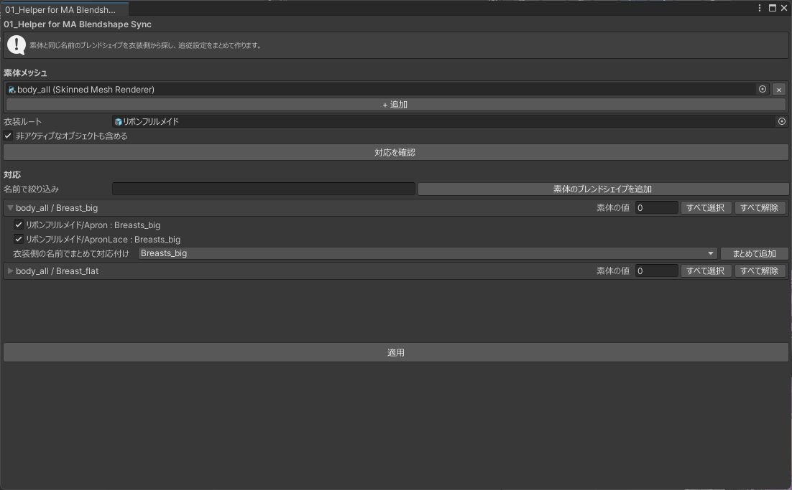

# 01_Helper for MA Blendshape Sync

素体のブレンドシェイプに衣装のブレンドシェイプを追従させる MA Blendshape Sync の設定を、まとめて作ります。MA Blendshape Sync は衣装のメッシュごとに付け、対応を 1 行ずつ入力する必要があります。このツールは同じ名前のブレンドシェイプを探して対応を提案し、チェックしたものを設定します。

必要なパッケージ: Modular Avatar 1.17.0 以降

## 使い方

1. 「素体メッシュ」に、アバターの体や顔のメッシュを指定します。複数指定できます。
2. 「衣装ルート」に、同じアバターの中の衣装を指定します。中のメッシュが対象になります。
3. 「対応を確認」を押すと、見つかった対応が一覧になります。
4. 設定する行にチェックを入れ、「適用」を押します。

{ .shot loading=lazy }

「非アクティブなオブジェクトも含める」（既定でオン）を外すと、非表示のメッシュを対象から外します。

## 一覧の見かた

一覧は、素体のメッシュとブレンドシェイプの組ごとにまとまっています。

```
▼ Body / Shrink_Chest      [素体の値: 100]  [すべて選択 / 解除]
    [✓] Tops : Shrink_Chest                       設定済み
    [✓] Outer/Skirt : Shrink_Chest
```

- チェックの入った行が、適用後の設定です。すでに設定されている対応のチェックを外すと、適用したときにその対応を削除します。
- 「設定済み」は、すでに MA Blendshape Sync に入っている対応です。最初からチェックが入っています。
- 見出しの「素体の値」を変えると、素体のブレンドシェイプの値がその場で変わります。衣装が追従するかを見ながら確かめられます。

衣装に同じ名前のブレンドシェイプが無い素体のブレンドシェイプは、一覧に出ません。

## 名前が違うブレンドシェイプを対応させる { #different-names }

1. 「素体のブレンドシェイプを追加」で、素体のブレンドシェイプを選んで一覧に加えます。
2. そのまとまりの中で衣装のブレンドシェイプの名前を選び、「まとめて追加」を押します。

その名前のブレンドシェイプを持つ衣装のメッシュすべてに、対応を追加します。ブレンドシェイプを選ぶ欄では名前で検索できます。一覧の上の欄に入力すると、素体のブレンドシェイプの名前で一覧を絞り込めます。

## 注意

- 再生中は使えません。
- 素体メッシュと衣装ルートは、同じアバターの中に置いてください。
- 同じ名前かどうかは完全一致で判定します。空白や大文字・小文字の違いは別の名前として扱います。
- 削除するのは、一覧に出ていてチェックを外した対応だけです。指定していない素体メッシュの対応には触れません。
- 対応が 0 件になっても、MA Blendshape Sync のコンポーネントは削除しません。
- 適用と、素体のブレンドシェイプの値の変更は、Undo で取り消せます。

## よくある質問

### 「アバタールートが違います」と出る

素体メッシュと衣装ルートが、別のアバターの中にあります。衣装をアバターの中に移してください。

### 対応が 1 件も出ない

素体と衣装で、ブレンドシェイプの名前が違います。[名前が違うブレンドシェイプを対応させる](#different-names)の手順で追加してください。

### 適用したのに衣装が追従しない

素体のブレンドシェイプの値が 0 のままだと、見た目は変わりません。値を変えて確かめてください。

### 同じ名前のブレンドシェイプが 1 つのメッシュに 2 つある

それぞれ別のまとまりになります。追従させたいほうのまとまりでチェックを入れてください。
