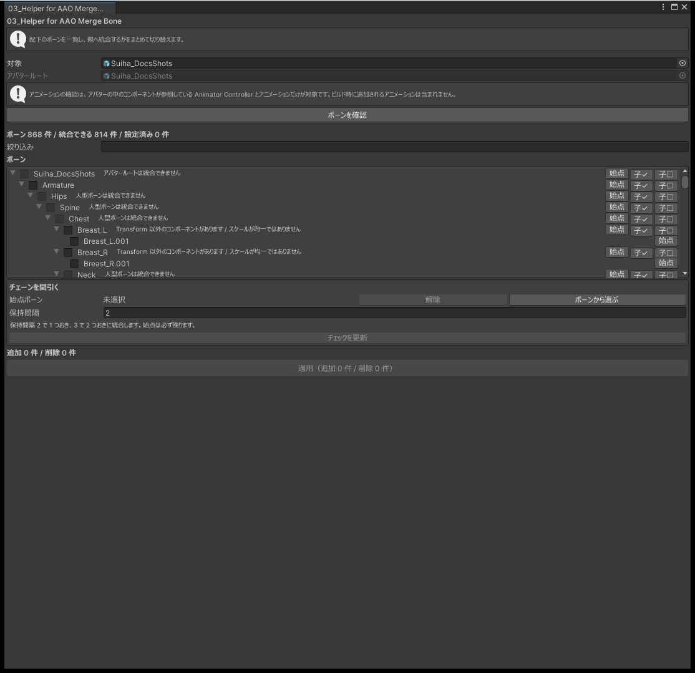

# 03_Helper for AAO Merge Bone

AAO Merge Bone は、親に統合したいボーンに 1 本ずつ付けるコンポーネントです。このツールはボーンをツリーで表示し、どのボーンを統合するかをチェックでまとめて切り替えます。

必要なパッケージ: AAO: Avatar Optimizer 1.9.0 以降

## 使い方

1. 対象のオブジェクトを 1 つ指定します。その中のボーンが対象です。
2. 「ボーンを確認」を押すと、ボーンのツリーと今の設定が出ます。
3. 親に統合するボーンにチェックを入れ、統合しないボーンのチェックを外します。
4. 「適用」を押します。

{ .shot loading=lazy }

ボーンの名前で絞り込んだり、ボーンとその子孫をまとめてチェックしたりできます。チェックを変えても、「適用」を押すまでシーンは変わりません。

## 印

| 印 | 対象 |
|---|---|
| 統合不可 | アバターのルート、Humanoid のボーン、`EditorOnly` のオブジェクト |
| 注意 | `Transform` 以外のコンポーネントを持つボーン |
| 注意 | アニメーションで動くボーン |

「アニメーションで動くボーン」は、アバターの中のコンポーネントが使う Animator Controller とアニメーションから調べます。ビルドのときに追加されるアニメーションは調べられないので、印が無くても動くボーンがあります。統合してから動かなくなったボーンがあれば、チェックを外して適用し直してください。

## チェーンを間引く

髪・しっぽ・スカートなどの長いボーンのチェーンを、決まった間隔で統合して本数を減らします。

1. 「チェーンを間引く」で、始まりのボーンと、残す間隔を指定します。
2. 間隔に合わせて、統合するボーンにチェックが入ります。

- 始まりのボーンは必ず残します。
- チェーンが枝分かれしているところで止まります。枝の先は、それぞれ始まりのボーンを指定して間引いてください。

## 注意

- 再生中は使えません。
- 今あるコンポーネントの設定値は書き換えません。
- 適用は Undo で取り消せます。

## よくある質問

### チェックできないボーンがある

アバターのルート、Humanoid のボーン、`EditorOnly` のオブジェクトは統合できません。一覧に理由が出ます。

### 統合したらアクセサリーの位置がずれた

`Transform` 以外のコンポーネントを持つボーンや、アニメーションで動くボーンを統合すると起きることがあります。印の付いたボーンのチェックを外して、適用し直してください。
