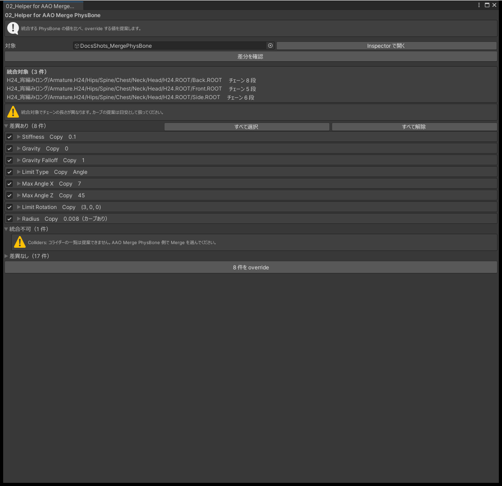

# 02_Helper for AAO Merge PhysBone

AAO Merge PhysBone は、統合する PhysBone どうしで値が違う項目があると、同じ値にするか override するよう求めます。このツールは、統合する PhysBone の値を項目ごとに並べて比べ、override する値を提案して書き込みます。

必要なパッケージ: AAO: Avatar Optimizer 1.9.0 以降

## 使い方

1. AAO Merge PhysBone が付いたオブジェクトを 1 つ指定します。
2. 「差分を確認」を押すと、統合する PhysBone の値が項目ごとに並びます。
3. 値が違う項目ごとに、提案に使う指標を選びます。
4. 書き込む項目にチェックを入れ、「適用」を押します。override として書き込みます。

{ .shot loading=lazy }

## 一覧の見かた

| まとまり | 内容 |
|---|---|
| 差異あり | 値が違うので、override が必要な項目です。最初から開いています |
| 差異なし | 値がすべて同じ項目です。件数だけが出ます |
| 統合不可 | 提案を作れない項目です。理由が出ます |

各項目には、統合する PhysBone ごとの値が、アバターのルートからのパスとチェーンの長さとともに並びます。1 つの PhysBone だけ値が違うときは、そのことが表示されます。

値の違いは完全一致で判定します。わずかな差も「差異あり」になります。

## 提案の指標

| 値の種類 | 選べる指標 |
|---|---|
| 数値・ベクトル | 最小、最大、平均、中央、最頻 |
| オン・オフ、種類、権限 | 最頻だけ |

既定は最頻です。提案された値は、適用する前に書き換えられます。書き換えた項目には印が付き、「統計値に戻す」で提案の値に戻ります。

## カーブのある項目

カーブのある項目は、値とカーブを掛けた結果どうしを統合し、それを値とカーブに分けて書き込みます。

- 書き込むカーブは 11 点を直線でつないだものです。元のカーブの曲がり方（タンジェント）は再現しません。
- 統合する PhysBone のチェーンの長さが違うときは、カーブの同じ位置が同じボーンを指さないので、提案は目安です。

## 提案を作らない項目

| 項目 | 代わりの設定 |
|---|---|
| Colliders | AAO Merge PhysBone の `Merged`（両方のリストをつなぐ）を使います |
| Endpoint Position | AAO Merge PhysBone の `Cleared` を使います |

## 注意

- 再生中は使えません。
- 一度に扱える AAO Merge PhysBone は 1 つです。
- どの PhysBone を統合するかは変えません。統合する PhysBone の追加や削除は、AAO Merge PhysBone のインスペクターでしてください。
- 適用は Undo で取り消せます。

## よくある質問

### 「差異なし」なのに、ビルドで override を求められる

統合する PhysBone が変わっていないか確かめ、「差分を確認」を押し直してください。

### 統合する PhysBone が一覧に出ない

AAO Merge PhysBone に統合する PhysBone が入っているかを確かめてください。

### 適用したらカーブの形が変わった

書き込むカーブは 11 点を直線でつないだものなので、元の形とは少し違います。形をそのままにしたいときは、適用したあとにインスペクターで直してください。
