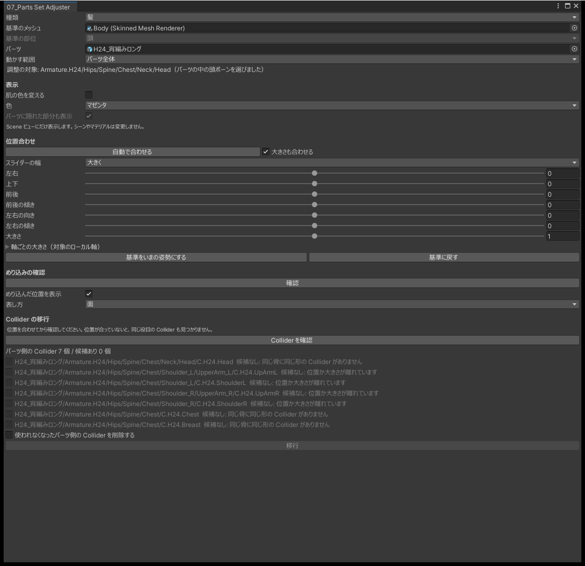
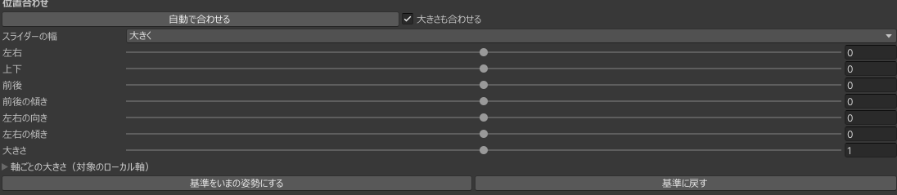
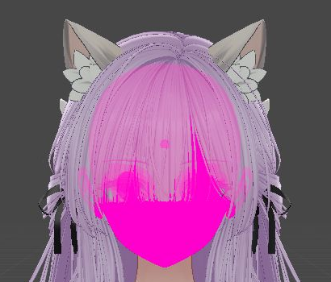
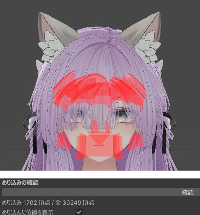

# 07_Parts Set Adjuster

別のアバター用の髪・帽子・眼鏡・しっぽ・羽・腕輪などを、体に合わせて取り付けます。アバターの軸に沿ったスライダーで位置・角度・大きさを整えます。髪は、顔の形を見て位置と大きさを自動で合わせられます。パーツに付いた PhysBone Collider を、本体の Collider に付け替えることもできます。

必要なパッケージ: VRChat SDK - Base 3.5.0 以降

0.8 までは `07_Hair Set Adjuster` という名前でした。

{ .shot loading=lazy }

## 使い方

1. 新しいパーツをアバターの中に置きます。髪を替えるときは、元の髪を外しておきます。
2. 種類・基準のメッシュ・基準の部位・パーツ・動かす範囲を指定します。
3. 「肌の色を変える」をオンにして、パーツと肌の境目を見やすくします。
4. 髪のときは「自動で合わせる」を押します。
5. スライダーで位置・角度・大きさを整え、めり込みを確かめます。
6. パーツに PhysBone Collider があれば、「Collider を確認」を押してから「移行」を押します。

位置の調整、自動で合わせる、Collider の移行は、どれも Undo で取り消せます。エディタで動かした位置は、アップロードのときの Modular Avatar などの統合でもそのまま使われます。

## 入力

| 入力 | 内容 |
|---|---|
| 種類 | 「髪」か「髪以外」。「自動で合わせる」は髪のときだけ使えます |
| 基準のメッシュ | 合わせる先の肌のメッシュ。髪なら顔、しっぽなら体など |
| 基準の部位 | 頭・腰・左手など 20 か所から選びます。髪のときは頭です |
| パーツ | アバターの中に置いた、取り付けるパーツ |
| 動かす範囲 | パーツ全体、ボーンを指定、メッシュを指定、から選びます |

| 動かす範囲 | 動かすもの |
|---|---|
| パーツ全体 | パーツの中の、基準の部位にあたるボーン。無ければパーツのルート |
| ボーンを指定 | 指定したボーンとその子。衣装の中の帽子だけを動かすときは、帽子のボーンを指定します |
| メッシュを指定 | 指定したメッシュを動かしているボーン |

ほかのメッシュと同じボーンで動くメッシュは、それだけを動かすことはできません。一緒に動くメッシュは、入力欄の下に表示されます。範囲を指定したときは、めり込みのチェックと「自動で合わせる」も、動く頂点だけで測ります。

## 位置・角度・大きさ

「左右」「上下」「前後」は、アバターのルートの軸に沿って動かします。角度と大きさは、基準の部位を中心に変わります。「軸ごとの大きさ」は、動かす対象のローカル軸ごとの倍率です。

{ .shot loading=lazy }

- スライダーは今の値を中心に動きます。端まで動かして離すと、その値が新しい中心になります。
- 右の数値欄には、スライダーの幅を超える値も入れられます。
- 「スライダーの幅」で「大きく」「ふつう」「細かく」を選べます。

「基準をいまの姿勢にする」を押すと、今の姿勢をスライダーの基準にします。「基準に戻す」で、その姿勢に戻ります。アバターそのものを動かしたあとは、基準を取り直してください。

### 自動で合わせる（髪のみ）

髪の中の頭のボーンをアバターの頭のボーンに合わせた位置から始め、頭の上半分へのめり込み、外から見える地肌、頭から浮いた部分が減るように、位置と大きさを変えます。すでに合っている髪は、ほとんど動きません。

- 変えるのは位置と、縦横奥行きそろえた大きさだけです。角度と軸ごとの大きさは変えません。
- 位置だけを合わせたいときは、「大きさも合わせる」をオフにします。
- 頭のボーンが無い髪にも使えますが、合わせたあとに後頭部やうなじの地肌が見えていないかを確かめてください。

## 肌の色を変える

基準のメッシュを、マゼンタ・シアン・黄のどれか 1 色で表示します。パーツは手前にそのまま見えるので、地肌のはみ出しや、パーツを肌が突き抜けているところが分かりやすくなります。

{ .shot loading=lazy }

- Scene ビューにだけ表示します。Game ビューには出ません。
- 「パーツに隠れた部分も表示」（既定でオン）では、パーツの奥の肌が同じ色で薄く表示されます。
- ウィンドウを閉じると元の表示に戻ります。シーンやマテリアルは変えていません。

## めり込みの確認

「確認」を押すと、基準の部位の表面より内側にあるパーツの頂点の数と、測った頂点の数が出ます。表面から深く離れた頂点は数えないので、パーツがすっかり体に埋まっているときは目で確かめてください。

{ .shot loading=lazy }

- 「めり込んだ位置を表示」がオンなら、その場所を Scene ビューに表示します。
- 「表し方」で「面」（既定）・「点」・「面と点」を選べます。面は、めり込んだ頂点を含む面を半透明の赤で塗ります。点は 2,000 点まで表示します。
- 数は、自動で合わせたあとと、スライダーを動かし終えたあとに更新されます。ほかの操作で動かしたときは、もう一度「確認」を押してください。

## Collider の移行

パーツの PhysBone が使っているパーツ側の Collider を、本体側の同じような Collider に付け替えます。

1. 「Collider を確認」を押すと、付け替える先の候補が出ます。形・付いているボーン・位置・大きさの近いものが候補になります。平面の Collider は対象外です。
2. 移す行にチェックを入れ、「移行」を押します。

- 位置を合わせてから確認してください。位置がずれていると候補に出ません。
- 本体側の Collider の値は変えません。
- 「使われなくなったパーツ側の Collider を削除する」をオンにしたときだけ、アバターのどの PhysBone からも使われなくなった Collider のコンポーネントを削除します。ボーンや GameObject は残します。

## 注意

- 再生中は使えません。
- メッシュの形は変えられません。
- 基準の部位のボーンがアバターに無いときは、近い部位を選んでください。

## よくある質問

### 自動で合わせた大きさが合わない

「大きさも合わせる」をオフにして押し直し、大きさはスライダーで整えてください。

### 「自動で合わせる」が押せない

種類が「髪以外」になっています。

### 帽子だけを動かしたいのに、ほかの飾りも動く

同じボーンで動いているので、帽子だけは動かせません。入力欄の下の「一緒に動くメッシュ」を確かめてください。

### 基準の部位を選ぶと「ボーンがありません」と出る

そのアバターには、その部位のボーンがありません。上胸・首・肩のボーンは無いことがあります。近い部位を選んでください。

### スライダーが動かない

アバターを動かしたあとは、「基準をいまの姿勢にする」を押してください。
