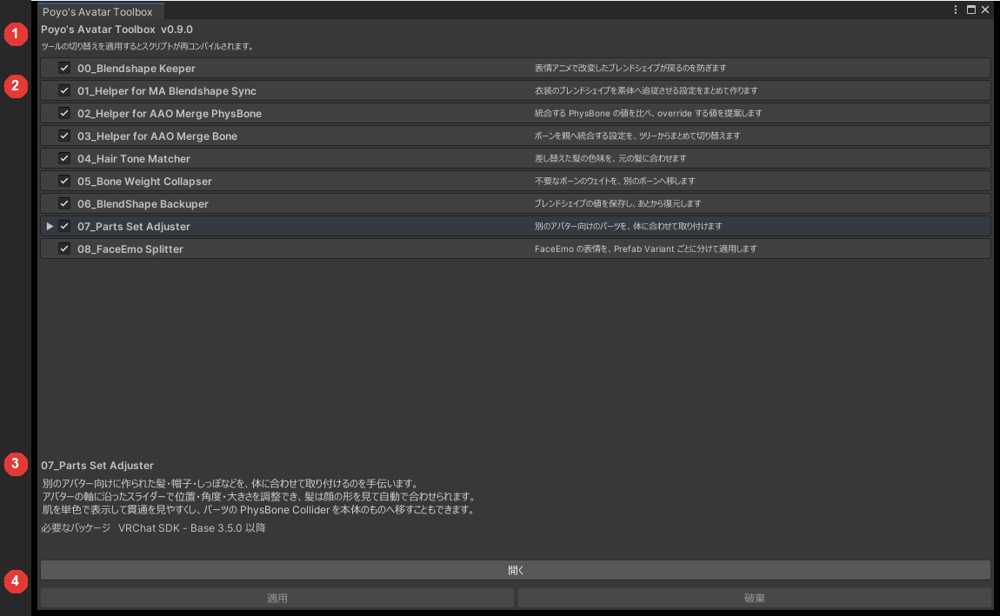
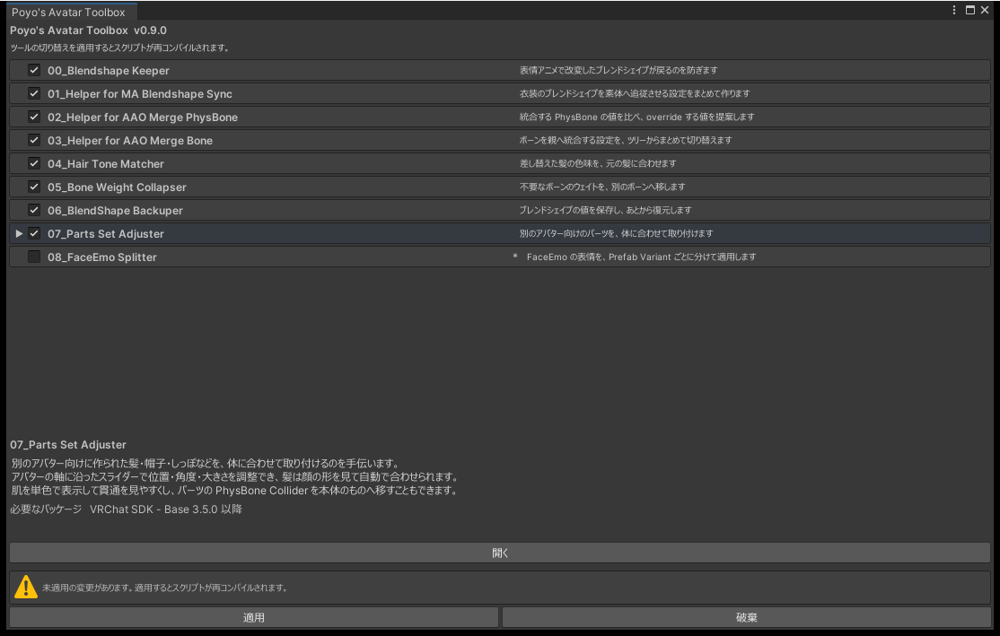

# 設定ウィンドウ

`Tools > Poyo's Avatar Toolbox` で開きます。ツールの有効・無効を切り替え、ツールのウィンドウを開きます。

{ .shot loading=lazy }

| 番号 | 場所 | 内容 |
|---|---|---|
| 1 | 上部 | パッケージ名とバージョン |
| 2 | 中央 | ツールの一覧。行をクリックすると、そのツールを選択します |
| 3 | 下部 | 選択したツールの説明と、必要なパッケージ |
| 4 | 最下部 | 「開く」と、「適用」「破棄」のボタン |

## ツールを有効にする

1. 使うツールのチェックを入れます。
2. 「適用」を押します。スクリプトの再コンパイルが始まります。
3. 再コンパイルが終わったら、ツールの行を選んで「開く」を押します。

チェックを入れただけでは有効になりません。「適用」を押すまでは、行に `*` が付き、ウィンドウに警告が出ます。「破棄」を押すと、チェックが元に戻ります。いくつかのツールを切り替えても、再コンパイルは 1 回です。

{ .shot loading=lazy }

再コンパイルの間は、チェックとボタンを操作できません。

## 「開く」が押せないとき

ボタンに理由が出ます。

| 表示 | 対処 |
|---|---|
| 無効です | チェックを入れて「適用」を押します |
| コンパイル中… | 再コンパイルが終わるまで待ちます |
| 必要なパッケージがありません | 下部に出ているパッケージを入れます |

必要なパッケージが入っていないツールは、チェックを入れられません。有効にしたあとで必要なパッケージを外すと、そのツールはコンパイルされなくなりますが、有効の設定は残ります。パッケージを入れ直せば、また使えます。

## 設定の保存先

有効にしたツールは、プロジェクト設定の Scripting Define Symbols に `AVATAR_TOOLBOX_TOOL_番号` として保存します。

- PC・Android・iOS の 3 つのビルドターゲットに書き込むので、プラットフォームを切り替えても有効のままです。
- プロジェクト設定に入るので、Git などで共有するとほかの人の環境でも同じツールが有効になります。
